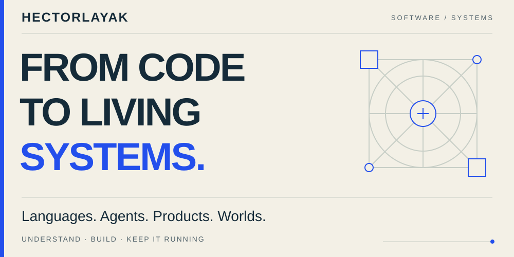
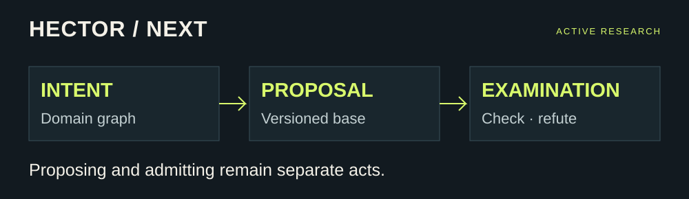
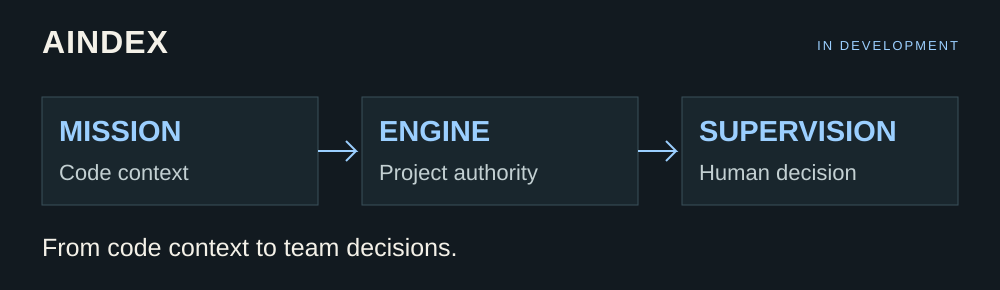

<picture>
  <source media="(prefers-color-scheme: dark)" srcset="assets/atelier/identity-en-dark.svg">
  <source media="(prefers-color-scheme: light)" srcset="assets/atelier/identity-en-light.svg">
  
</picture>

<a href="#01--tools-for-development">Languages &amp; agents</a> · <a href="#02--connecting-use-cases">Products</a> · <a href="#03--bringing-worlds-to-life">Worlds</a> · <a href="#the-whole-workshop">All 33 projects</a> · <a href="README.md">Français</a>

I build tools for developing with agents, business platforms and multiplayer worlds. Their common ground: **understandable rules, shared state, and components that can recover after an interruption.**

C# / .NET · Rust · TypeScript · C / C++ · Python

This profile opens the whole workshop: products, research, prototypes and collaborations. [The studio](https://floriansola.fr/en) presents selected work for client projects.

## 01 / Tools for development

**HECTOR — The agent programs the problem. Hector explores its realization.**

A program becomes a typed, versioned graph of domain facts. The agent proposes a change against a precise base; the owner retains admission. Derivation, counterexample search and native compilation explore how to reduce the technical decisions left to agents. **Active research.**

[The language and its boundaries →](projects/hector.en.md)

**AINDEX — Agents do the work. Humans oversee it.**

The Rust engine connects goals, missions, symbols and code dependencies. It organizes work and verification. Studio and the editor extension give the team a shared view of context, activity and changes to review. **In development.**

[The product and its architecture →](projects/aindex.en.md)

## 02 / Connecting use cases

Applications where one action crosses several responsibilities, from a user’s gesture to persistent data.

| Product | What it connects |
| :--- | :--- |
| **[OneRP](projects/onerp-framework.en.md)** | A SaaS backend, administration and FiveM modules: characters, economy, inventories and vehicles. |
| **[StaffingOS](projects/staffingos.en.md)** | Assignments, time, expenses and approvals through payroll and invoicing preparation. |
| **[RoadTripper](projects/roadtripper.en.md)** | A travel itinerary, map, group, expenses and a copilot’s proposals. |
| **[SaleCast](projects/salecast.en.md)** | Sales channels, orders and replenishment planning. |
| **[Matchr](projects/matchr.en.md)** | A job offer, targeted CV and application tracking. |

## 03 / Bringing worlds to life

Games are an architectural playground: server authority, networking, persistence, simulation and the player interface need to describe the same state.

| World | The work |
| :--- | :--- |
| **[FantasyOnline](projects/fantasy-online.en.md)** | A persistent fantasy world, causal terrain generation, .NET game rules and a Unity client. |
| **[Poisson Engine](projects/poisson-engine.en.md)** | Shoals, predation and mutations; WebGPU/CPU computation separated from WebGL/Canvas2D rendering. |
| **[Survival Unreal](projects/survival-unreal.en.md)** | The project’s own contracts, online services and zone networking, connected to its HUD and Unreal systems. |
| **[Nexus / Reclaim City](projects/nexus.en.md)** | Recover wrecks and develop a district; Luau gameplay and .NET operations tools. |

Operations belong to the work: [VPS Command Center](projects/vps-command-center.en.md) and [self-hosted infrastructure](projects/self-hosted-infrastructure.en.md) connect services, versions, delivery and recovery.

## The whole workshop

**33 projects**, organized into four areas. Products, research, tools and collaborations.

<strong>Languages, AI & agents</strong> · 9 projects

| Project | Domain |
| :--- | :--- |
| [AINDEX](projects/aindex.en.md) | Agents do the work. Humans oversee the project. |
| [HECTOR](projects/hector.en.md) | A versioned domain graph: propose, verify and admit separately. |
| [Continuum](projects/continuum.en.md) | Learn to navigate, then measure decisions in a reproducible laboratory. |
| [PromptVault](projects/promptvault.en.md) | Turn a team’s prompts into reusable tools |
| [Matchr](projects/matchr.en.md) | One offer, a targeted CV and a tracked application dossier. |
| [ModelRisk Observatory · GeopolAI](projects/geopolai.en.md) | Compare AI-model responses under controlled scenarios |
| [AISelector](projects/ai-selector.en.md) | One contract for multiple AI providers |
| [Vouch](projects/vouch.en.md) | Prepare security answers from traceable sources |
| [Vision Security Lab](projects/vision-security-lab.en.md) | Observe automated behaviour from visual input. |

<strong>Business products & collaboration</strong> · 6 projects

| Project | Domain |
| :--- | :--- |
| [OneRP](projects/onerp-framework.en.md) | A SaaS foundation for operating FiveM roleplay worlds. |
| [SaleCast](projects/salecast.en.md) | Connect sales channels and plan the next replenishment. |
| [StaffingOS](projects/staffingos.en.md) | Connect assignments, time, expenses and financial preparation. |
| [RoadTripper](projects/roadtripper.en.md) | A shared itinerary, a map and a copilot for travelling together. |
| [PartyFlow](projects/partyflow.en.md) | Create a room, gather players and move through timed challenges |
| [Racine](projects/racine.en.md) | A family space for connections and shared memories |

<strong>Worlds, games & simulation</strong> · 13 projects

| Project | Domain |
| :--- | :--- |
| [FantasyOnline](projects/fantasy-online.en.md) | A persistent fantasy world, from generated terrain to server rules. |
| [FantasyOnline.Shared](projects/fantasy-online-shared.en.md) | Share contracts and rules through explicit adoption by each game. |
| [Nexus / Reclaim City](projects/nexus.en.md) | Recover wrecks and rebuild a district of your own. |
| [SurvivalKingdom](projects/survival-kingdom.en.md) | Connect survival, a multiplayer world and the services that sustain it. |
| [Survival Unreal](projects/survival-unreal.en.md) | A survival world connected to its own game services. |
| [REWORLD](projects/reworld.en.md) | Build an atlas, connect its territories and write their story. |
| [MANDATE EARTH](projects/mandate-earth.en.md) | Prepare a plan, commit resources and track the consequences. |
| [Symbiont](projects/symbiont.en.md) | Grow a colony without exhausting the world that feeds it. |
| [Poisson Engine](projects/poisson-engine.en.md) | A living ecosystem simulated in the browser. |
| [Ultra RP](projects/ultra-rp-sbox.en.md) | A s&box roleplay world, from player jobs to operations tooling |
| [Development Tycoon](projects/development-tycoon.en.md) | Design the growth of a software studio as a management game. |
| [Red Dead Roleplay](projects/red-dead-roleplay.en.md) | Compose a roleplay world around characters and interactions. |
| [V-Multi / SARP](projects/gaming-platform.en.md) | A formative journey through multiplayer and community worlds. |

<strong>Infrastructure, tools & background</strong> · 5 projects

| Project | Domain |
| :--- | :--- |
| [VPS Command Center](projects/vps-command-center.en.md) | Connect service health to operational decisions. |
| [Self-hosted Infrastructure](projects/self-hosted-infrastructure.en.md) | Organise product hosting, delivery and recovery. |
| [Portfolio Engineering](projects/portfolio-engineering.en.md) | Turn recurring problems into reusable components. |
| [Gecko IoT](projects/gecko-iot.en.md) | Professional experience close to embedded software. |
| [Integrations & Archives](projects/integrations-archives.en.md) | Preserve adapters, experiments and early versions. |

---

[Studio & services](https://floriansola.fr/en) · [Notes and articles](https://floriansola.fr/en/blog) · [Français](README.md)
