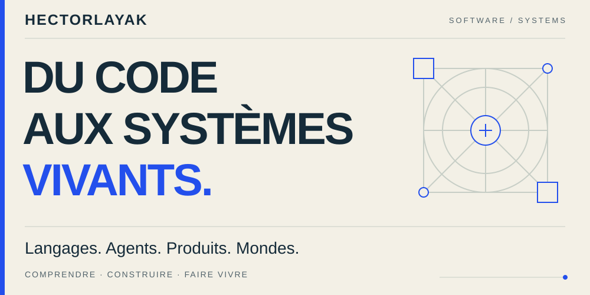

<picture>
  <source media="(prefers-color-scheme: dark)" srcset="assets/atelier/identity-fr-dark.svg">
  <source media="(prefers-color-scheme: light)" srcset="assets/atelier/identity-fr-light.svg">
  
</picture>

<a href="#01--outiller-le-développement">Langages &amp; agents</a> · <a href="#02--relier-les-usages">Produits</a> · <a href="#03--faire-vivre-des-mondes">Mondes</a> · <a href="#tout-latelier">Les 33 projets</a> · <a href="README.en.md">English</a>

Je conçois des outils pour développer avec des agents, des plateformes métier et des mondes multijoueurs. Ce qui les relie : **des règles compréhensibles, un état partagé et des composants capables de se retrouver après une interruption.**

C# / .NET · Rust · TypeScript · C / C++ · Python

Ce profil ouvre tout l’atelier : produits, recherche, prototypes et collaborations. [Le studio](https://floriansola.fr) présente une sélection de réalisations pour les projets clients.

## 01 / Outiller le développement

**HECTOR — L’agent programme le problème. Hector explore sa réalisation.**

Un programme devient un graphe typé et versionné de faits métier. L’agent propose un changement contre une base précise ; le propriétaire garde l’admission. Dérivation, recherche de contre-exemples et compilation native cherchent à réduire les décisions techniques laissées à l’agent. **Recherche active.**

[Le langage et ses frontières →](projects/hector.md)

**AINDEX — Les agents opèrent. Les humains supervisent.**

Le moteur Rust relie objectifs, missions, symboles et dépendances du code. Il organise le travail et ses vérifications. Studio et extension donnent à l’équipe une vue commune du contexte, de l’activité et des changements à examiner. **En développement.**

[Le produit et son architecture →](projects/aindex.md)

## 02 / Relier les usages

Des applications où une action traverse plusieurs responsabilités, du geste de l’utilisateur à la donnée persistante.

| Produit | Ce qu’il relie |
| :--- | :--- |
| **[OneRP](projects/onerp-framework.md)** | Un backend SaaS, une administration et des modules FiveM : personnages, économie, inventaires et véhicules. |
| **[StaffingOS](projects/staffingos.md)** | Missions, temps, frais et validations jusqu’à la préparation de la paie et de la facturation. |
| **[RoadTripper](projects/roadtripper.md)** | Un programme de voyage, la carte, le groupe, les dépenses et les propositions d’un copilote. |
| **[SaleCast](projects/salecast.md)** | Les canaux de vente, les commandes et la préparation du réapprovisionnement. |
| **[Matchr](projects/matchr.md)** | Une offre, un CV ciblé et le suivi du dossier de candidature. |

## 03 / Faire vivre des mondes

Le jeu est aussi un terrain d’architecture : autorité serveur, réseau, persistance, simulation et interfaces du joueur doivent raconter le même état.

| Monde | Le chantier |
| :--- | :--- |
| **[FantasyOnline](projects/fantasy-online.md)** | Monde fantasy persistant, génération causale du terrain, règles de jeu .NET et client Unity. |
| **[Poisson Engine](projects/poisson-engine.md)** | Bancs, prédation et mutations ; calcul WebGPU/CPU séparé du rendu WebGL/Canvas2D. |
| **[Survival Unreal](projects/survival-unreal.md)** | Contrats, services en ligne et réseau de zones propres au projet, reliés au HUD et aux systèmes Unreal. |
| **[Nexus / Reclaim City](projects/nexus.md)** | Récupérer des épaves et faire évoluer son district ; gameplay Luau et outils d’exploitation .NET. |

L’exploitation fait partie du travail : [VPS Command Center](projects/vps-command-center.md) et [l’infrastructure auto-hébergée](projects/self-hosted-infrastructure.md) relient services, versions, livraison et reprise.

## Tout l’atelier

**33 projets**, organisés en quatre terrains. Produits, recherche, outils et collaborations.

<strong>Moteurs, IA & agents</strong> · 9 projets

| Projet | Domaine |
| :--- | :--- |
| [AINDEX](projects/aindex.md) | Les agents opèrent. Les humains supervisent le projet. |
| [HECTOR](projects/hector.md) | Un graphe métier versionné : proposer, vérifier et admettre séparément. |
| [Continuum](projects/continuum.md) | Apprendre à naviguer, puis mesurer les décisions dans un laboratoire reproductible. |
| [PromptVault](projects/promptvault.md) | Transformer les prompts d’une équipe en outils réutilisables |
| [Matchr](projects/matchr.md) | Une offre, un CV ciblé, un dossier de candidature suivi. |
| [ModelRisk Observatory · GeopolAI](projects/geopolai.md) | Comparer les réponses de modèles IA sur des scénarios contrôlés |
| [AISelector](projects/ai-selector.md) | Un contrat commun pour appeler plusieurs fournisseurs IA |
| [Vouch](projects/vouch.md) | Préparer des réponses de sécurité à partir de sources traçables |
| [Vision Security Lab](projects/vision-security-lab.md) | Observer des comportements automatisés à partir de l’image. |

<strong>Produits métier & collaboration</strong> · 6 projets

| Projet | Domaine |
| :--- | :--- |
| [OneRP](projects/onerp-framework.md) | Un socle SaaS pour exploiter des mondes roleplay FiveM. |
| [SaleCast](projects/salecast.md) | Relier les canaux de vente et préparer le prochain réapprovisionnement. |
| [StaffingOS](projects/staffingos.md) | Relier missions, temps, frais et préparation des sorties financières. |
| [RoadTripper](projects/roadtripper.md) | Un programme commun, une carte et un copilote pour voyager à plusieurs. |
| [PartyFlow](projects/partyflow.md) | Créer un salon, réunir les joueurs et enchaîner les défis |
| [Racine](projects/racine.md) | Un espace familial pour garder les liens et les souvenirs |

<strong>Mondes, jeux & simulation</strong> · 13 projets

| Projet | Domaine |
| :--- | :--- |
| [FantasyOnline](projects/fantasy-online.md) | Un monde fantasy persistant, du terrain généré aux règles serveur. |
| [FantasyOnline.Shared](projects/fantasy-online-shared.md) | Partager les contrats et les règles, avec une adoption explicite par jeu. |
| [Nexus / Reclaim City](projects/nexus.md) | Récupérer des épaves et reconstruire un district à son image. |
| [SurvivalKingdom](projects/survival-kingdom.md) | Relier la survie, un monde multijoueur et les services qui le font durer. |
| [Survival Unreal](projects/survival-unreal.md) | Un monde de survie relié à ses propres services de jeu. |
| [REWORLD](projects/reworld.md) | Composer un atlas, relier ses territoires et écrire leur histoire. |
| [MANDATE EARTH](projects/mandate-earth.md) | Préparer un plan, engager des ressources et en suivre les conséquences. |
| [Symbiont](projects/symbiont.md) | Faire grandir une colonie sans épuiser le monde qui la nourrit. |
| [Poisson Engine](projects/poisson-engine.md) | Un écosystème vivant simulé dans le navigateur. |
| [Ultra RP](projects/ultra-rp-sbox.md) | Un monde roleplay s&box, du métier du joueur aux outils d’exploitation |
| [Development Tycoon](projects/development-tycoon.md) | Concevoir la croissance d’un studio logiciel comme un jeu de gestion. |
| [Red Dead Roleplay](projects/red-dead-roleplay.md) | Composer un monde roleplay autour des personnages et des interactions. |
| [V-Multi / SARP](projects/gaming-platform.md) | Un parcours fondateur dans le multijoueur et les mondes communautaires. |

<strong>Infrastructure, outils & parcours</strong> · 5 projets

| Projet | Domaine |
| :--- | :--- |
| [VPS Command Center](projects/vps-command-center.md) | Relier la santé des services aux décisions d’exploitation. |
| [Infrastructure auto-hébergée](projects/self-hosted-infrastructure.md) | Organiser l’hébergement, la livraison et la reprise des produits. |
| [Portfolio Engineering](projects/portfolio-engineering.md) | Transformer les problèmes récurrents en composants réutilisables. |
| [Gecko IoT](projects/gecko-iot.md) | Une expérience professionnelle au contact du logiciel embarqué. |
| [Intégrations & archives](projects/integrations-archives.md) | Conserver les adaptateurs, les essais et les premières versions. |

---

[Studio & services](https://floriansola.fr) · [Notes et articles](https://floriansola.fr/blog) · [English](README.en.md)
