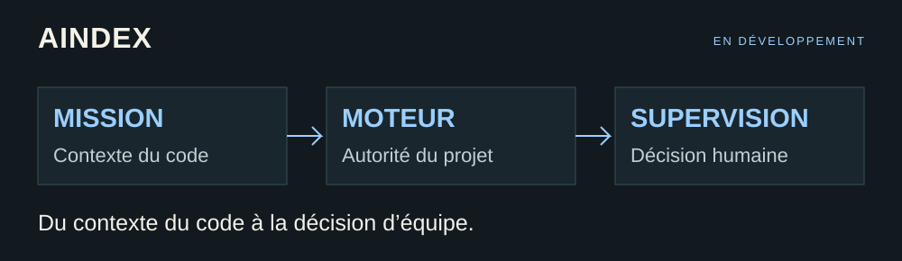

# AINDEX

**Les agents opèrent. Les humains supervisent le projet.**

[Tous les projets](../README.md#tout-latelier) · [English](aindex.en.md)

Confier du développement à des agents demande de relier chaque changement à une demande, à des fichiers autorisés et à des vérifications. AINDEX rassemble ces éléments : objectifs, missions, contexte du code, exécution et résultats examinables.

Le moteur Rust indexe les symboles et leurs relations. Il possède aussi l’autorité du projet : tâches, permissions, réservations de travail et validations. La couche de contexte fournit le contrat de mission et les références utiles, puis relit l’état du projet à la reprise. Lire le contexte ne donne pas l’autorisation de modifier le code.

## Une mission reliée au projet

1. Rattacher la demande à un objectif, à un périmètre et aux règles du dépôt.
2. Fournir les contrats, dépendances, références et observations utiles au travail.
3. Suivre l’activité, les changements et les vérifications dans la supervision commune.
4. Examiner les éléments produits et décider de la suite.

## Des responsabilités séparées

**Le moteur porte l’autorité.** Studio, extension et lecteurs présentent les contrats du projet ; ils ne recréent pas une vérité concurrente de Project/Gate.

**Le contexte reste une observation.** Son origine et sa fraîcheur comptent pour la mission. Il ne remplace ni les permissions ni les validations.

**Le compte commercial ne possède pas le dépôt.** Les comptes, licences, équipes et la facturation PostgreSQL restent distincts des permissions sur le code. La passerelle expose seulement les lectures privées autorisées.

Le mode démonstration est choisi explicitement lorsque le moteur est indisponible. Les écrans de démonstration portent des données fictives et ne constituent pas un résultat mesuré sur un projet réel.

**État : en développement.** Moteur natif, supervision humaine et extension d’éditeur ; les gains de productivité et de tokens demandent une mesure sur une mission complète.

[Présentation du projet ↗](https://floriansola.fr/projects/aindex)
