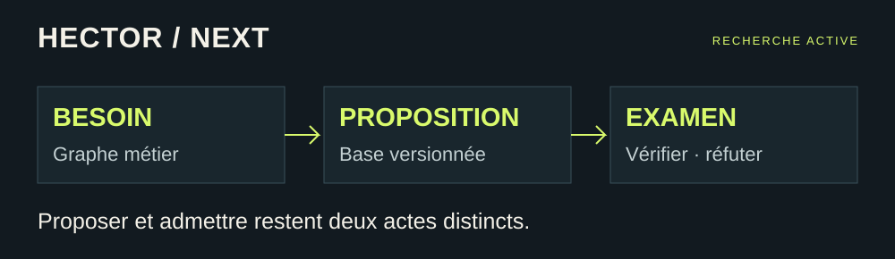

# HECTOR

**L’agent programme le problème. Hector explore sa réalisation.**

[Tous les projets](../README.md#tout-latelier) · [English](hector.en.md)

HECTOR NEXT recherche une autre répartition du travail : l’auteur exprime l’intention, les faits et les règles métier ; l’agent propose un changement ; Hector en examine les conséquences et les obligations qu’il sait vérifier. Le but est de réduire les décisions techniques laissées à l’agent.

Le programme est un graphe typé et versionné, avec des identités qui survivent au renommage. Les propositions visent une révision précise. Le texte et le Studio sont des représentations de ce programme ; l’interface d’agent permet de lire, d’explorer et de proposer. L’admission reste un acte distinct du propriétaire.

## Du besoin à la réalisation

1. Exprimer les faits et les contraintes du domaine.
2. Dériver les obligations et faire apparaître la question métier manquante.
3. Examiner une proposition et son impact sur une base identifiée.
4. Distinguer résultat établi, contre-exemple, refus et conclusion inconnue.
5. Explorer une réalisation native et la mesurer dans son périmètre.

## Les choix qui structurent la recherche

**Le contrat avant la réalisation.** Les règles métier ne choisissent pas implicitement un algorithme, une représentation mémoire ou un backend. Ces décisions appartiennent au travail de réalisation.

**Proposer n’est pas admettre.** CLI, serveur MCP et Studio partagent le modèle du programme, mais la lecture ou une proposition d’agent ne constitue pas une autorisation d’intégration.

**Une garantie porte une portée.** Dérivation, vérification, recherche de contre-exemples et mesure produisent des résultats distincts. Un résultat inconnu garde cet état.

La chaîne associe **Rust, Hector et LLVM**. Le noyau, les outils d’édition, la preuve et la réalisation native avancent par tranches ; le Studio expose le graphe et les propositions.

**État : recherche active.** Les parcours complets, la qualification multiplateforme et les gains de performance restent à établir.

[Présentation du projet ↗](https://floriansola.fr/projects/hector)
